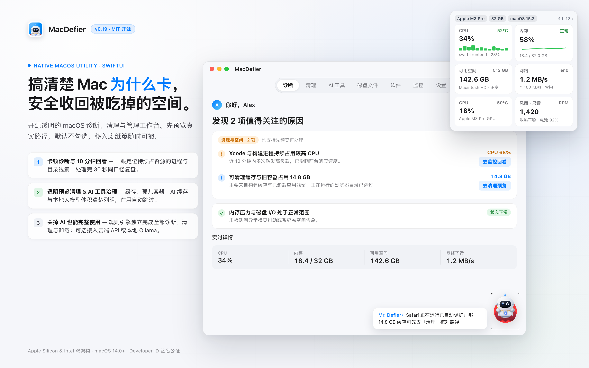
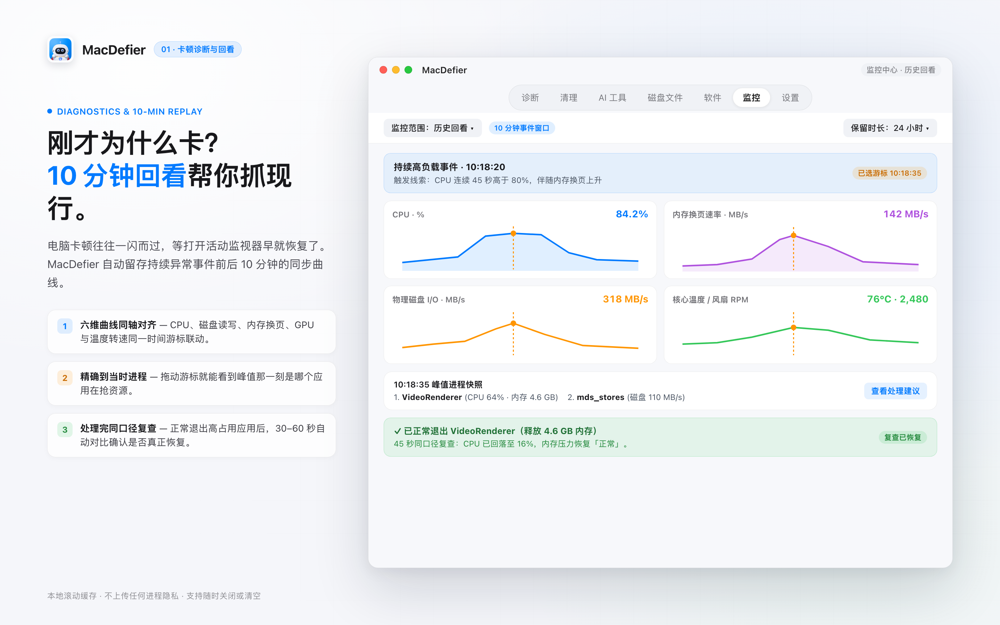
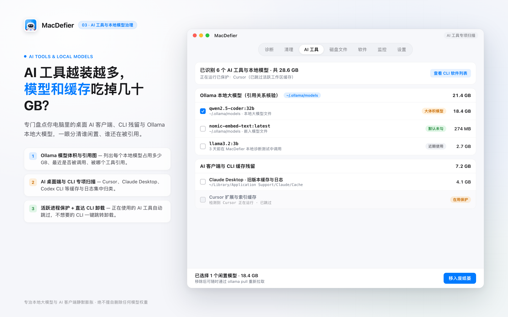
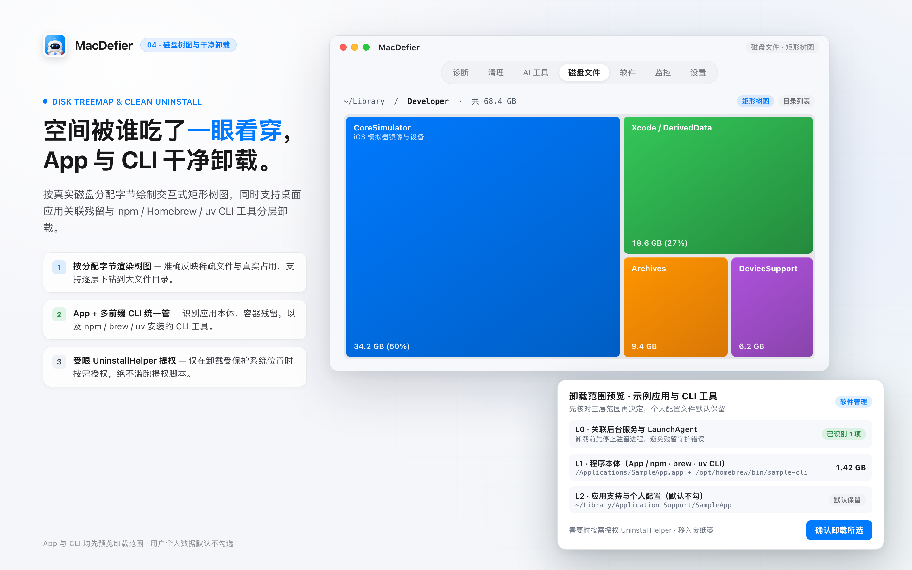
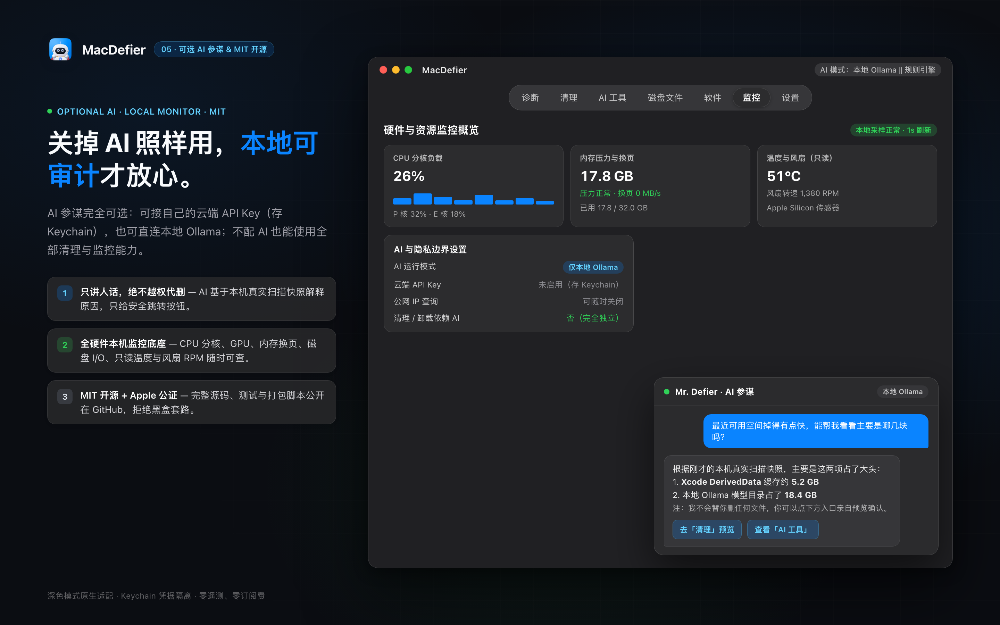

<p align="right"><strong>中文</strong> · <a href="README_EN.md">English</a></p>

<div align="center">
  
  <h1>MacDefier for macOS</h1>
  <p><strong>搞清楚 Mac 为什么卡、垃圾在哪、空间被谁吃了，并安全收回被吃掉的空间。</strong></p>
  <p>原生 macOS 打造 · 先预览、默认不勾、移入废纸篓可撤销 · 原生系统管理与诊断工具，不是杀毒软件</p>
  <p>
    <a href="https://kun97.tech/dl/macdefier"><strong>⬇️ 立即下载 MacDefier 0.21（官网公证 DMG · 19 MB）</strong></a>
    &nbsp;·&nbsp;
    <a href="https://github.com/KunZhang1997/MacDefier/releases/download/v0.21/MacDefier-0.21.dmg">GitHub 镜像下载</a>
    &nbsp;·&nbsp;
    <a href="https://github.com/KunZhang1997/MacDefier/releases/latest">版本说明与 SHA-256</a>
    &nbsp;·&nbsp;
    <a href="#从源码构建">从源码构建</a>
    &nbsp;·&nbsp;
    <a href="#三步极速上手">三步上手</a>
    &nbsp;·&nbsp;
    <a href="README_EN.md">English</a>
  </p>
</div>



> **核心原则**：规则引擎与 AI 参谋平行协作——**关掉 AI 也能完整使用全部诊断、清理、卸载与监控能力**。所有演示截图均为脱敏示例数据。

---

## 为什么需要 MacDefier？

电脑突然变卡时，活动监视器满屏英文进程看不懂；磁盘空间告急时，又怕闭源清理软件“一键全选”误删正在用的浏览器数据或开发缓存。

| 对比维度 | 系统活动监视器 / 极客监控墙 | 传统闭源订阅清理软件 | MacDefier（MIT 开源方案） |
| --- | --- | --- | --- |
| **卡顿诊断** | 只看当前瞬时数字，卡顿一过就抓不到 | 偏重扫描评分与恐吓提示 | **10 分钟持续卡顿回看** + 退出高占用应用后 30–60 秒复查 |
| **清理安全边界** | 需手工翻 `~/Library` 目录，容易删错 | 常默认勾选大类、闭源黑盒清理 | **默认全部不勾**，先看真实路径，在用浏览器自动跳过，移入废纸篓可撤销 |
| **AI 工具与模型** | 无专项识别 | 缺少针对本地大模型与 CLI 的治理 | **专项盘点 Ollama 本地大模型、AI 客户端缓存与 CLI 残留** |
| **透明与成本** | 免费但门槛高 | 年费订阅制、源码不可审计 | **免费下载公证版 + MIT 完整开源**，不绑定云端账号 |

---

## 五大核心体验

### 1. 卡顿诊断与 10 分钟时间线回看：刚才为什么卡，一眼抓现行

卡顿往往只持续几十秒，等你切到监视器时已经恢复。MacDefier 自动留存异常事件前后 10 分钟的同步曲线，把 CPU、内存换页、物理磁盘 I/O、GPU 与温度转速对齐到同一根时间游标上，直接定位当时的峰值进程；正常退出高占用应用后，30–60 秒内同口径复查是否真正恢复。



---

### 2. 透明预览清理：默认不勾、在用自动保护、移入废纸篓可撤销

MacDefier 不做恐吓式评分，也不搞“一键黑盒全删”。扫描完成后所有条目**默认不勾选**，每一项都列明真实磁盘路径与占用体积；检测到 Safari、Chrome 等应用正在运行时自动跳过并标明原因，避免误清登录态。确认清理后移入废纸篓，随时可以从访达放回原处。


---

### 3. AI 时代的专项空间治理：看清本地大模型与 AI 工具缓存

装了一堆桌面 AI 客户端、CLI 工具和 Ollama 本地模型后，几十 GB 空间经常不知不觉被吃光。MacDefier 专门盘点 Ollama 本地模型的体积、最近调用与引用关系，以及 Claude Desktop、Cursor 等工具的缓存和日志，在用进程自动保护，闲置大体积模型一眼认出、安全回收。



---

### 4. 磁盘矩形树图（Treemap）+ App 与多前缀 CLI 干净卸载

想知道空间到底被哪个深层目录吃了，打开「磁盘文件」按**实际分配字节**渲染交互式矩形树图，逐层下钻到大文件目录。需要卸载软件时，不仅支持常规 App 与残留容器，还能识别 npm / Homebrew / uv 安装的 CLI 工具，分层预览 L0 后台服务、L1 程序本体与 L2 个人数据（默认不勾），必要时按需授权 `UninstallHelper` 完成清理。



---

### 5. 可选 AI 参谋 + 本机监控底座 + MIT 开源可审计

MacDefier 内置原生硬件监控中心（CPU 分核、GPU、内存压力与换页、物理磁盘 I/O、只读温度与风扇 RPM）与菜单栏双列实时状态面板。右下角窗宠 `Mr. Defier` 作为可选 AI 参谋，支持自配云端 API Key（存 macOS Keychain）或直连本地 Ollama：

- **只讲人话，绝不代删**：AI 仅基于本机真实扫描快照解释原因，并给出安全的白名单跳转按钮。
- **规则引擎完全独立**：关闭 AI 后，全部诊断、清理、卸载与监控功能零影响。



---

## 为什么完全免费且开源？

MacDefier 采用 **MIT License** 开源，不靠制造焦虑或订阅制收费。你可以直接下载经过 Apple 公证的免费安装包，也可以自己拉取源码审阅并编译。

| 发行方式 / 路线 | 说明与适用人群 |
| --- | --- |
| **官方公证直装版（推荐）** | 下载 `MacDefier-0.21.dmg`（约 19 MB），已通过 Apple Developer ID 签名与公证，支持完整本地扫描、废纸篓清理与 `UninstallHelper` 按需授权卸载，免费使用。 |
| **MIT 源码自构建** | 仓库公开完整 SwiftUI 应用、单元测试与构建脚本，适合开发者自行审计、定制或从源码运行。 |
| **后续演进方向（路线图）** | 已立项 P1 能力：**Defence · AI 读盘越权预警**（监控合法 AI 工具是否因工作区配置过宽而读取敏感私密目录，首期以透明预警与规则可撤为原则，**非杀毒/非木马引擎**；尚未在 `v0.21` 交付）。 |

---

## 三步极速上手

1. **下载安装包**：从[官方网站](https://kun97.tech/macdefier/)或 [GitHub Releases](https://github.com/KunZhang1997/MacDefier/releases/download/v0.21/MacDefier-0.21.dmg) 获取 **MacDefier-0.21.dmg**（约 `19 MB`，需要 **macOS 14.0 Sonoma 或更高版本**，原生支持 **Apple Silicon 与 Intel** 双架构）。
2. **拖入应用程序**：打开 `.dmg`，将 `MacDefier.app` 拖入 `/Applications`（应用程序）并启动。
3. **按需授权**：仅当需要扫描或清理受 macOS 保护的目录时，再按提示前往「系统设置 → 隐私与安全性 → 完全磁盘访问权限」勾选允许 MacDefier。

`v0.21` 发布校验（`dist/release/SHA256SUMS`）：

```text
470622826fcebb1c3e9b7890f21d49cb2974c6fdf3f2855252f7261e8505f867  MacDefier-0.21.dmg
```

### 数据与权限透明表

| 项目 | 行为与边界说明 |
| --- | --- |
| **扫描与清理** | 全部在本机执行，不上传文件列表或个人目录结构；绝大多数清理移入废纸篓，详情以确认页为准。 |
| **AI 参谋（可选）** | 默认关闭或仅在配置后启用；配置云端 API 时仅发送当前诊断/扫描摘要给你的目标服务，API Key 存于 macOS Keychain；配置本地 Ollama 时数据不离开本机/局域网。 |
| **公网 IP 查询** | 监控中心网络页的公网 IP 查询会请求第三方服务，可在设置中随时关闭。 |

---

## 常见问题（FAQ）

<details>
<summary><strong>不配置 AI 可以使用全部诊断、清理和卸载功能吗？</strong></summary>

可以。MacDefier 采用「规则引擎 ‖ AI 平行」架构，诊断、清理预览、磁盘矩形树图、App/CLI 卸载以及硬件监控均由本地规则与系统 API 独立完成，完全不依赖 AI。

</details>

<details>
<summary><strong>清理会误删正在使用的浏览器数据，或者删完无法恢复吗？</strong></summary>

不会黑盒强删。首先，扫描结果默认全部不勾选，你需要先预览真实路径再自行决定；其次，检测到浏览器或 AI 工具正在运行时会自动跳过受保护目录；最后，常规清理统一移入废纸篓，可在访达中随时还原。

</details>

<details>
<summary><strong>MacDefier 和 Stats、CleanMyMac 有什么区别？</strong></summary>

Stats 偏向极客高密度传感器监控，CleanMyMac 属于闭源订阅制商业清理套件；MacDefier 面向普通 Mac 用户与 AI 使用者，把「卡顿诊断回看 + 透明安全清理 + AI 工具/模型治理 + 开源可审计」做进同一个原生工作台里。

</details>

<details>
<summary><strong>Intel Mac 可以使用吗？支持什么系统版本？</strong></summary>

支持。`MacDefier-0.21.dmg` 为 Universal 双架构安装包，原生支持 **Apple Silicon（M 系列）与 Intel Mac**，要求 **macOS 14.0 Sonoma 或更高版本**。部分硬件传感器（如温度/风扇只读指标）的可用性因机型与权限而异。

</details>

---

## 从源码构建

需要 macOS 14.0 或更新版本、Xcode（本次验证使用 Xcode 27.1），以及 [XcodeGen](https://github.com/yonaskolb/XcodeGen)。

```bash
brew install xcodegen
git clone https://github.com/KunZhang1997/MacDefier.git
cd MacDefier/app
./rebuild_and_launch.sh
```

日常重建使用 Release 与既有 `com.macdefier.app` 身份，只更新 `/Applications/MacDefier.app`。也可用 `bash app/scripts/install-app.sh /path/to/MacDefier.app` 安装已签名包或本地 Release 产物；旧 `install-dev-app.sh` 转到同一入口，不再安装第二份 Dev 应用。安装成功会清理输入的应用副本（只读挂载盘除外），不删除其父目录。

构建、安装、打包和 CI 共用产品锁；临时应用及其注册在成功、失败或正常中断时清理。新应用先验证再替换，替换或系统启动命令失败则恢复旧包；退出未完成时不强退。个人设置、对话、宠物、凭据、模型和旧 Dev 数据不迁移、不删除。Debug 保留供 CI 和临时调试，应用产物完成验证后清理。历史 DMG/ZIP 与非应用的编译缓存保留。

只验证脚本文件边界与回退，可运行 `bash app/rebuild_and_launch.sh --self-test`。该入口使用隔离文件，不重建或重启当前应用。

### 检查与测试

在仓库根目录执行现有测试和 Debug / Release 构建：

```bash
bash app/scripts/ci.sh
```

测试和构建使用隔离缓存目录。完整脚本会运行唯一构建锁与 Sparkle 更新源检查、`UninstallHelperKit` / `CleanupKit` / `PetArchiveKit` / `MonitorKit` 单元测试、`MacDefierTests` 主工程单元测试，再构建并校验 Debug 与双架构 Release 应用。

### 工程结构

| 路径 | 内容 |
| --- | --- |
| `app/MacDefier/` | SwiftUI 应用、诊断、AI 和界面资源 |
| `app/MacDefierTests/` | 主工程单元测试（AI、诊断、布局、更新、引导与本地化） |
| `app/CleanupKit/` | 扫描、清理、卸载及保护规则 |
| `app/MonitorKit/` | 系统资源采样 |
| `app/PetArchiveKit/` | 宠物包导入与校验 |
| `app/UninstallHelperKit/` | 卸载助手协议、权限边界、客户端与测试 |
| `app/UninstallHelper/` | 按需授权的卸载助手入口 |
| `app/Vendor/ZIPFoundation/` | 固定版本的 ZIPFoundation 依赖 |
| `app/scripts/` | 构建、校验与打包脚本 |

---

## 许可证与致谢

MacDefier 源码使用 [MIT License](LICENSE)。允许使用、修改、分发及商业使用，分发时须保留许可证及版权声明。

第三方组件保留各自许可证和署名，详见 [app/NOTICE](app/NOTICE)：[Stats](https://github.com/exelban/stats)、[PureMac](https://github.com/momenbasel/PureMac)、[ZIPFoundation](https://github.com/weichsel/ZIPFoundation)、[Sparkle](https://github.com/sparkle-project/Sparkle) 使用 MIT；示例宠物素材 [The Robot - Free Sprite](https://opengameart.org/content/the-robot-free-sprite) 使用 CC0。

欢迎通过 [Issues](https://github.com/KunZhang1997/MacDefier/issues) 报告问题，或提交 Pull Request。报告问题时请删除日志中的 API Key 和个人路径等私密信息。
